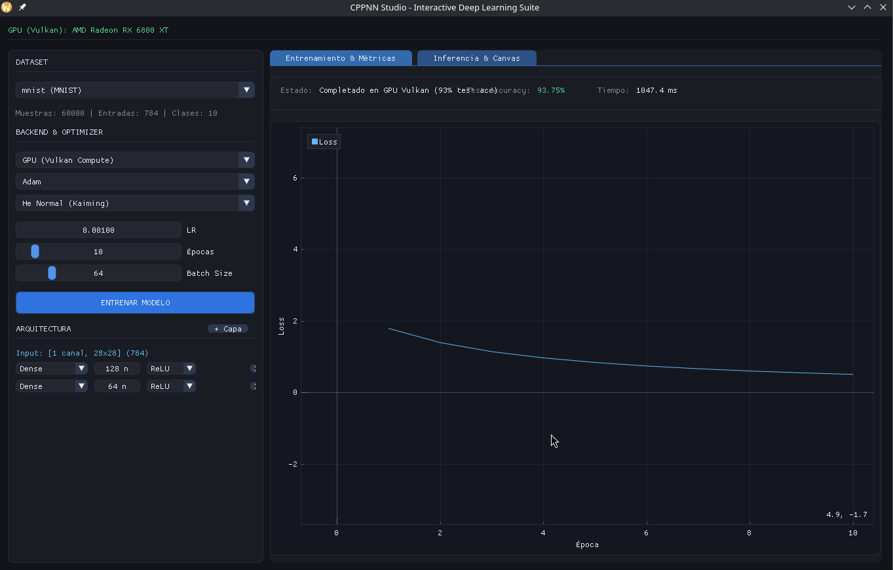
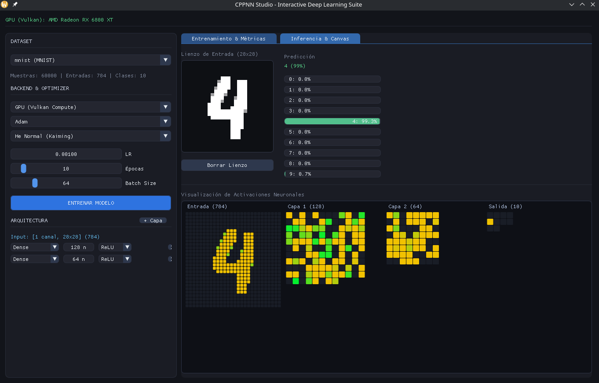

# CPPNN: Motor de Redes Neuronales y Cómputo Vulkan en C++

Un motor modular de aprendizaje profundo y estudio interactivo desarrollado desde cero en C++17, con soporte de aceleración por hardware mediante Vulkan Compute shaders, multihilo en CPU mediante Eigen y una interfaz gráfica en tiempo real basada en Dear ImGui.

[English](README.md) | [Español](README.es.md)

---

## Demostración

<p align="center">
  
</p>

<p align="center">
  
</p>

---

## Descripción

CPPNN implementa primitivas de redes neuronales y retropropagación (backpropagation) sin depender de librerías de alto nivel como PyTorch o TensorFlow. El procesamiento puede ejecutarse tanto en CPU multihilo como directamente en GPU mediante shaders de cómputo GLSL compilados a SPIR-V.

El proyecto cuenta con un entorno interactivo de escritorio para configuración dinámica de arquitecturas, monitoreo de métricas en tiempo real, lienzo de dibujo para inferencia sobre dígitos manuscritos y carga automática de datasets.

---

## Características Principales

- **Backends de Ejecución:**
  - **GPU (Vulkan Compute):** Forward pass, backpropagation y optimizadores ejecutados íntegramente en la GPU a través de compute pipelines de Vulkan y VMA (Vulkan Memory Allocator), minimizando transferencias host-dispositivo.
  - **CPU (Eigen & OpenMP):** Operaciones tensoriales multihilo y multiplicación matricial optimizada.
  - **CPU (Mono-hilo):** Implementación de referencia para depuración y verificación de gradientes.

- **Capas Disponibles:**
  - `Conv2D`: Convolución espacial 2D con soporte para número arbitrario de canales de entrada/salida, dimensiones de kernel, stride y padding con ceros.
  - `MaxPooling2D`: Max-pooling espacial 2D con rastreo de índices de máximos para el gradiente.
  - `Dense`: Capas totalmente conectadas con activación configurable.
  - `Flatten`: Aplanamiento de tensores N-dimensionales a tensores 2D.
  - `Dropout`: Regularización por dropout invertido.
  - `Rescaling`: Capa de normalización y escalado configurable ($scale \times x + offset$).

- **Optimizadores:**
  - `Adam`: Estimación adaptativa de momentos con corrección de sesgo para primer y segundo orden ($m_t$, $v_t$).
  - `SGDMomentum`: Descenso de gradiente estocástico con momento/inercia.
  - `SGD`: Descenso de gradiente estándar.

- **Inicialización de Pesos:**
  - `HeNormal` / `HeUniform` (Kaiming)
  - `GlorotUniform` / `GlorotNormal` (Xavier)
  - `LeCunNormal`
  - `RandomUniform`

- **Estudio Interactivo (Dear ImGui & ImPlot):**
  - Creación dinámica de capas, ajuste de hiperparámetros y cambio de backend en tiempo de ejecución.
  - Curvas de pérdida en vivo, seguimiento de épocas y evaluación de exactitud (accuracy) sobre conjunto de prueba.
  - Lienzo interactivo para reconocimiento de dígitos manuscritos (MNIST).
  - Escaneo automático de datasets tabulares (CSV) e imágenes.

---

## Estructura del Proyecto

```text
CPPNN/
├── include/CPPNN/
│   ├── VulkanNeuralTrainer.h   # Grafo de entrenamiento en GPU y dispatches de cómputo Vulkan
│   ├── VulkanGPUCompute.h      # Gestión de dispositivo Vulkan, buffers, descriptores y shaders
│   ├── Layers.h                # Implementación de capas en CPU (Conv2D, Dense, MaxPool, etc.)
│   ├── Optimizer.h             # Implementación de optimizadores en CPU (Adam, SGD, Momentum)
│   ├── ModelDevice.h           # Abstracción secuencial del modelo
│   ├── TensorDevice.h          # Abstracción de memoria tensorial y tags de dispositivo CPU/GPU
│   ├── StudioEngine.h          # Coordinación del entrenamiento y estado de la interfaz gráfica
│   ├── MNISTLoader.h           # Parser para archivos en formato IDX (MNIST)
│   └── UniversalDatasetLoader.h# Detección y carga de datasets
├── shaders/                    # Shaders de cómputo en GLSL compilados a SPIR-V
│   ├── conv2d_*.comp           # Forward, gradientes de parámetros y gradiente de entrada para Conv2D
│   ├── maxpool2d_*.comp        # Forward y backward para MaxPooling2D
│   ├── dense_*.comp            # GEMM forward, gradientes de pesos/biases y de entrada para Dense
│   ├── optimizer_*.comp        # Kernels de actualización en GPU para Adam, Momentum y SGD
│   ├── activation_*.comp       # Kernels de cómputo para ReLU y Softmax
│   └── rescaling_*.comp        # Kernels de cómputo para Rescaling
├── src/                        # Implementaciones y punto de entrada de la aplicación
├── datasets/                   # Datasets de prueba (MNIST, benchmarks tabulares)
└── CMakeLists.txt
```

---

## Requisitos Previos

- **Compilador C++:** Compatible con C++17 (GCC 9+, Clang 10+, MSVC 2019+)
- **Sistema de compilación:** CMake 3.15+
- **Vulkan SDK:** Versión 1.2+ con `glslangValidator` accesible en el `PATH`
- **Controlador Gráfico:** Driver de GPU con soporte para Vulkan (probado en AMD Radeon RX 6800 XT / Mesa RADV y NVIDIA)
- **Dependencias de Ventana (Linux):** `libx11-dev`, `libxcursor-dev`, `libxrandr-dev`, `libxinerama-dev`, `libxi-dev`, `libgl1-mesa-dev`

---

## Compilación y Ejecución

### 1. Clonar el repositorio

```bash
git clone https://github.com/tu-usuario/CPPNN.git
cd CPPNN
```

### 2. Configurar y compilar

```bash
cmake -B build -DCMAKE_BUILD_TYPE=Release
cmake --build build -j$(nproc)
```

El sistema CMake invoca automáticamente `glslangValidator` para compilar los shaders de `shaders/` a binarios SPIR-V (`.spv`) en el directorio de compilación.

### 3. Ejecutar la aplicación

```bash
./build/CPPNN
```

---

## Licencia

Este proyecto está bajo la Licencia MIT. Consulta el archivo [LICENSE](LICENSE) para más detalles.

