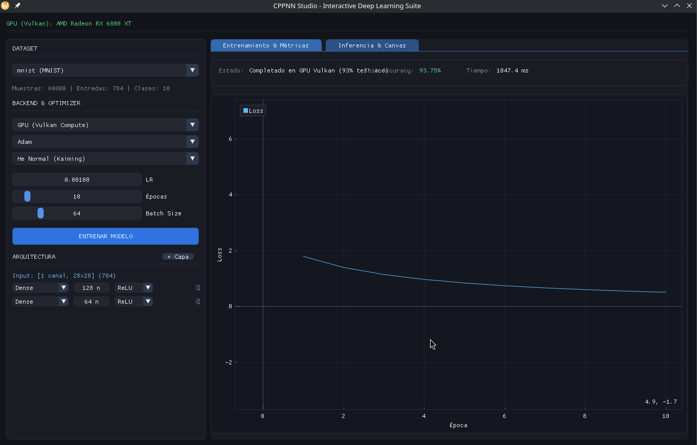
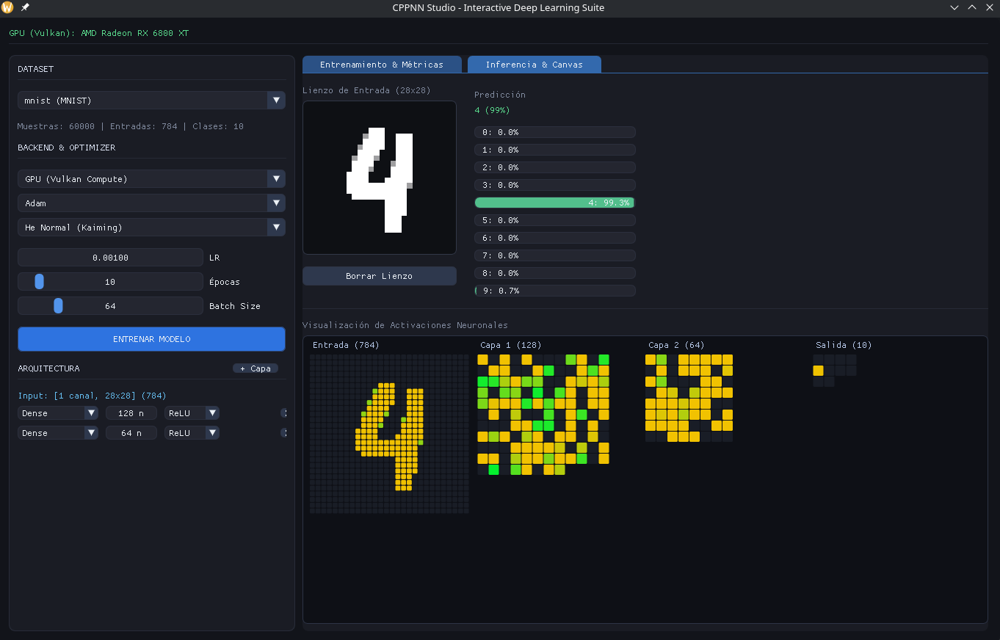

# CPPNN: C++ Neural Network & Vulkan Compute Engine

A modular deep learning engine and interactive training studio written in C++17 from scratch, featuring hardware-accelerated training and inference using Vulkan Compute shaders, Eigen-backed CPU multithreading, and a real-time Dear ImGui dashboard.

[English](README.md) | [Español](README.es.md)

---

## Preview

<p align="center">
  
</p>

<p align="center">
  
</p>

---

## Overview

CPPNN implements deep learning primitives and backpropagation without high-level machine learning frameworks (such as PyTorch or TensorFlow). Computation can be dispatched either to multi-threaded CPU routines or directly to the GPU via custom GLSL compute shaders compiled to SPIR-V.

The project includes an interactive desktop studio with real-time metrics, architecture configuration, drawing canvas for digit inference, and dataset loaders.

---

## Key Features

- **Execution Backends:**
  - **GPU (Vulkan Compute):** End-to-end forward pass, backpropagation, and optimizer steps running on the GPU via Vulkan compute pipelines and VMA (Vulkan Memory Allocator). Zero host-device synchronization bottlenecks during batch training.
  - **CPU (Eigen & OpenMP):** Multithreaded tensor operations and BLAS matrix multiplications.
  - **CPU (Single-threaded):** Baseline implementation for debugging and verification.

- **Layer Architectures:**
  - `Conv2D`: 2D spatial convolution with arbitrary input/output channels, kernel sizes, strides, and zero-padding.
  - `MaxPooling2D`: 2D spatial max-pooling with gradient index tracking.
  - `Dense`: Fully connected layers with customizable activation functions.
  - `Flatten`: N-dimensional to 2D tensor flattening.
  - `Dropout`: Inverted dropout regularization.
  - `Rescaling`: Configurable input normalization ($scale \times x + offset$).

- **Optimizers:**
  - `Adam`: Adaptive moment estimation with first and second moment bias corrections ($m_t$, $v_t$).
  - `SGDMomentum`: Stochastic gradient descent with velocity tracking.
  - `SGD`: Standard gradient descent.

- **Weight Initializations:**
  - `HeNormal` / `HeUniform` (Kaiming)
  - `GlorotUniform` / `GlorotNormal` (Xavier)
  - `LeCunNormal`
  - `RandomUniform`

- **Interactive Studio (Dear ImGui & ImPlot):**
  - Dynamic layer creation, parameter tuning, and backend switching at runtime.
  - Live loss curves, epoch tracking, and test accuracy evaluation.
  - Interactive drawing canvas for real-time digit recognition on MNIST.
  - Automatic dataset scanning for tabular CSVs and image datasets.

---

## Project Structure

```text
CPPNN/
├── include/CPPNN/
│   ├── VulkanNeuralTrainer.h   # GPU neural network training graph & Vulkan compute dispatches
│   ├── VulkanGPUCompute.h      # Vulkan device management, buffers, descriptors & shader compilation
│   ├── Layers.h                # CPU layer implementations (Conv2D, Dense, MaxPool, etc.)
│   ├── Optimizer.h             # CPU optimizer implementations (Adam, SGD, Momentum)
│   ├── ModelDevice.h           # Sequential model abstraction
│   ├── TensorDevice.h          # Tensor memory abstraction & CPU/GPU device tags
│   ├── StudioEngine.h          # Training orchestration and GUI state
│   ├── MNISTLoader.h           # IDX format parser for MNIST
│   └── UniversalDatasetLoader.h# Dynamic dataset discovery and ingestion
├── shaders/                    # GLSL compute shaders compiled to SPIR-V
│   ├── conv2d_*.comp           # Conv2D forward, param gradients, and input gradients
│   ├── maxpool2d_*.comp        # MaxPool2D forward and backward pass
│   ├── dense_*.comp            # Dense GEMM forward, weight/bias gradients, input gradients
│   ├── optimizer_*.comp        # GPU Adam, Momentum, and SGD update kernels
│   ├── activation_*.comp       # ReLU, Softmax compute kernels
│   └── rescaling_*.comp        # Rescaling compute kernels
├── src/                        # Source implementations and application entry point
├── datasets/                   # Sample datasets (MNIST, tabular benchmarks)
└── CMakeLists.txt
```

---

## Prerequisites

- **C++ Compiler:** C++17 compatible (GCC 9+, Clang 10+, MSVC 2019+)
- **Build System:** CMake 3.15+
- **Vulkan SDK:** 1.2+ with `glslangValidator` in system `PATH`
- **Graphics Driver:** Vulkan-compatible GPU driver (tested on AMD Radeon RX 6800 XT / Mesa RADV and NVIDIA)
- **Windowing Dependencies (Linux):** `libx11-dev`, `libxcursor-dev`, `libxrandr-dev`, `libxinerama-dev`, `libxi-dev`, `libgl1-mesa-dev`

---

## Building and Running

### 1. Clone the repository

```bash
git clone https://github.com/your-username/CPPNN.git
cd CPPNN
```

### 2. Configure and build

```bash
cmake -B build -DCMAKE_BUILD_TYPE=Release
cmake --build build -j$(nproc)
```

The build system automatically invokes `glslangValidator` to compile all `.comp` shaders in `shaders/` into SPIR-V binaries (`.spv`) inside the build tree.

### 3. Run the application

```bash
./build/CPPNN
```

---

## License

This project is licensed under the MIT License. See the [LICENSE](LICENSE) file for details.
